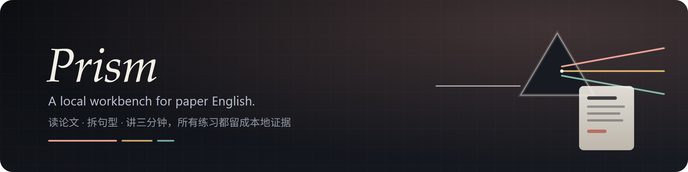
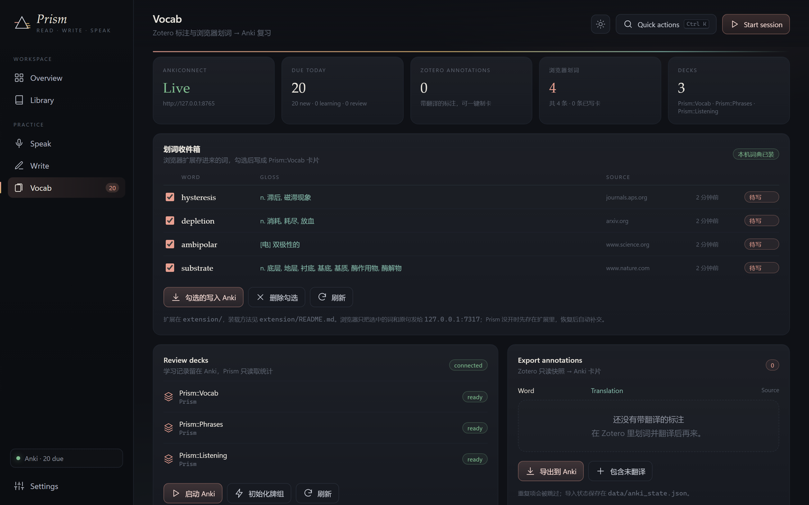
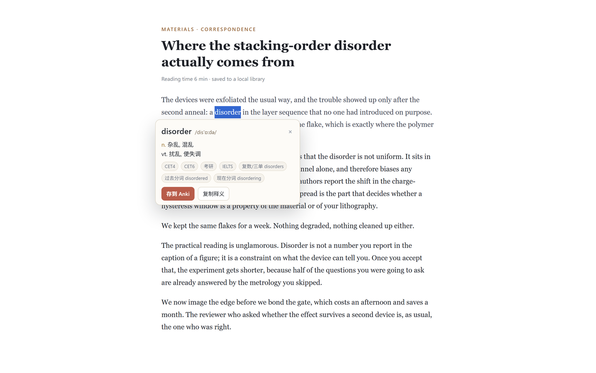
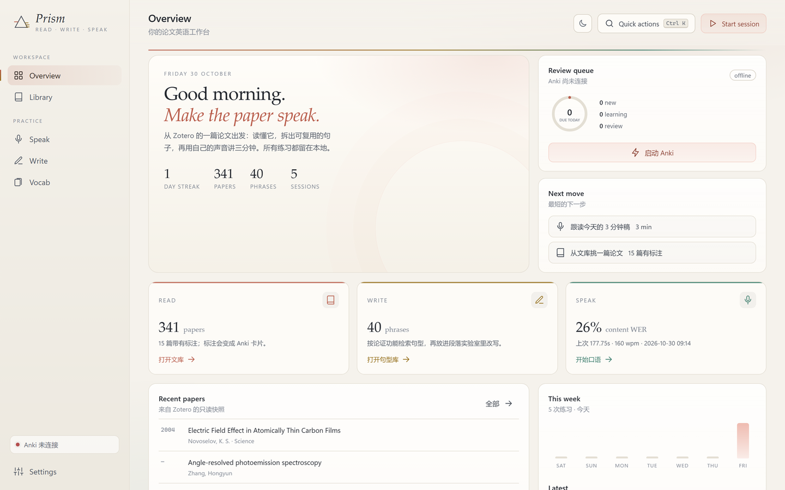

<p align="center">
  
</p>

<h1 align="center">Prism</h1>

<p align="center"><strong>You finished the paper. Can you say it out loud?</strong><br>One paper, split into reading, writing and speaking — with records you can compare.</p>

<p align="center">
  <b>English</b> · <a href="README.zh-CN.md">简体中文</a>
</p>

<p align="center">
  <a href="https://lumenhao.github.io/Prism/"><strong>Website</strong></a> ·
  <a href="#one-click-start">One-click start</a> ·
  <a href="#six-workspaces">Six workspaces</a> ·
  <a href="#faq">FAQ</a>
</p>

<p align="center"><sub>Windows 10/11 · Python 3.12 · nothing leaves your machine · MIT</sub></p>

**Prism** is a local-first desktop workbench for academic English. Pick a paper out of Zotero, turn it into a three-minute talk, hear a reference reading, record yourself, get a comparable report, and push the annotations into Anki — from one window.

---

## Where you are probably stuck

**You read it, but you cannot say it.** Good sentences evaporate on the read-through. When it is your turn to speak, all that survives is "This paper is about…".

**You can edit it, but it stops sounding like you.** A template here, a grammar checker there, a polishing tool somewhere else — copy, paste, repeat, until the paragraph belongs to nobody.

**You learn the words, but never use them.** Annotations stay in Zotero, reviews happen in Anki, speaking practice lives in a third app. Busy every day, no visible progress.

Prism is not another feature list. It puts **one and the same paper** through a loop: read it in Library, take it apart in Write, say it in Speak, review it in Vocab. Every session leaves a record you can compare against the next one.

## One-click start

You do not need Python installed, and you do not need to read a long setup guide.

1. **Get the code**: `git clone https://github.com/Lumenhao/Prism.git`, or use **Code → Download ZIP** on GitHub and unzip.
2. **Double-click `Prism.bat`.**
   On the first run it creates `.venv`, installs the dependencies and points the model cache at `E:\LumenSuite`. About 1.5 GB, typically 5–15 minutes. When it finishes, the workbench opens by itself.
3. **(Optional) plug in your own material**:
   - **Zotero**: once Zotero is installed, set the path to `zotero.sqlite` in Prism's Settings. It looks for `~/Zotero/zotero.sqlite` by default.
   - **Anki**: install Anki plus [AnkiConnect](https://ankiweb.net/shared/info/2055492159) (add-on code `2055492159`), start Anki, then click **Vocab → 初始化牌组** (initialise decks).

The first synthesis or analysis downloads Kokoro (~330 MB) and Whisper `base.en` (~150 MB) through `hf-mirror.com` into `E:\LumenSuite\models`. After that it runs offline.

> Requirements: Windows 10/11 x64, network access for the first install, ~6 GB free disk. Without an E: drive it falls back to `%LOCALAPPDATA%\LumenSuite`; you can also set the `LUMEN_SUITE` environment variable.

### Where things get installed

```text
E:\LumenSuite
├─ Prism\      code, .venv, data (recordings / reports / snapshots)
├─ models\     Kokoro, Whisper, ECDICT (browser dictionary), HF / Torch caches
├─ tools\      Python 3.12, Anki, Vale, FFmpeg (when present)
└─ cache\      uv / pip / download cache
```

Prism's own output lives in `data/` and is git-ignored; machine-specific paths go into `config.local.json`, which is never committed.

## The first ten minutes

1. **Overview**: see this week's practice, the size of your Zotero library and the Anki queue. Hit **Start session** to jump straight into speaking.
2. **Library**: search and open a paper you have to present soon, click **生成讲述稿** (generate talk script).
3. **Speak**: pick the `af_heart` voice, generate the reference audio, read along, upload your recording and click **Analyze** for WER, pauses, waveform and pitch.
4. **Write**: browse Phrasebank patterns by rhetorical function (Introduction / Methods / Results / Discussion), insert one into the paragraph lab, click **检查段落** (check paragraph).
5. **Vocab**: export Zotero annotations that carry a translation into Anki cards in one click, then review them tomorrow.

<table>
<tr>
<td></td>
<td></td>
</tr>
<tr>
<td></td>
<td></td>
</tr>
<tr>
<td></td>
<td></td>
</tr>
</table>

<p align="center"></p>

<p align="center"></p>

## Clip words while you read in the browser

Reading happens in the browser, not in the workbench — so the words you meet there come back on their own.

1. **Vocab → 安装本地词典** downloads ECDICT (66 MB → 770,611 entries, MIT) once and indexes it on `E:\LumenSuite\models\ecdict`. After that, lookups are offline and take milliseconds.
2. Load `extension/` as an unpacked extension (`chrome://extensions` → developer mode → **Load unpacked**; the same folder works in Edge). Details in [extension/README.md](extension/README.md).
3. Select any English word or phrase on any page: a small card shows the phonetic transcription, Chinese glosses, exam tags (CET / TOEFL / IELTS / GRE) and inflections. **存到 Anki** stores the word, the sentence it came from and the page URL.
4. Back in **Vocab → 划词收件箱**, tick the rows and click **勾选的写入 Anki** — cards land in `Prism::Vocab` with the context sentence and a link back to the source.

If Prism is closed when you clip, the extension keeps the entry and hands it over by itself within a minute of the workbench coming back. Nothing is sent anywhere except `127.0.0.1:7317`; the extension's only host permission is that address.

## Six workspaces

| Workspace | What it solves | How you use it |
|---|---|---|
| **Overview** | What should I practise today | Day streak, due cards, last speaking report; **Start session** opens the loop |
| **Library** | Papers scattered in Zotero, unreadable and unsplittable | Search title / author / venue; read abstract, tags, annotations; open the PDF, jump to Zotero; generate a 3-minute talk script |
| **Speak** | You can read it, but nobody tells you how you sound | **Listen** builds the reference audio; **Terms** gives YouGlish context for 17 terms; **Analyze** takes your recording and returns transcript, WER, pauses, waveform and pitch |
| **Write** | You forget the sentences you meant to reuse | Search 40 Phrasebank patterns by function, click to insert into the paragraph lab, get actionable edits from Vale plus built-in rules |
| **Vocab** | Annotations and reviews live apart | Browser clips and Zotero annotations both land here; tick them and export to Anki; see due counts for the three decks; launch Anki or initialise decks |
| **Settings** | Paths, ports, models — where are they | Change the Anki URL, Anki path, Zotero library, Kokoro voice, Whisper model; check the real status of each tool; switch dark / light |

Long jobs (TTS, recording analysis, Anki import) run in the background with progress at the top; the window stays responsive and switching pages does not cancel them.

## What makes this more than a bundle of tools

- **One thread**: Read → Write → Speak → Review. Each page shows only the input and result for the current step instead of dumping a toolbox on you.
- **Local-first**: Zotero is read through a snapshot; Anki talks to `127.0.0.1:8765`; recordings, transcripts and reports are never uploaded.
- **Comparable**: record the same script repeatedly; reports keep WER, pauses and pitch, and sessions feed the week view and the streak.
- **Exitable**: every capability also has a command-line entry (below). The workbench strings them together; it is not a black box.

## FAQ

**Anki keeps saying "not connected" — is it the deck name?**
No. The connection depends on exactly three things: Anki is running, the AnkiConnect add-on is installed and enabled, and the port is `8765`. Decks are named `Prism::Vocab` / `Prism::Phrases` / `Prism::Listening` for branding only; old `PaperToTalk::*` decks have their cards migrated and the empty shells removed when you click **Vocab → 初始化牌组**.

**Why is the first start slow?**
It installs CPU builds of PyTorch, Kokoro and faster-whisper and puts the caches on E:. Later starts take a few seconds.

**Do my papers or recordings get uploaded?**
No. Downloading models is the only network step; practice data is written to the local `data/` folder.

**Can I skip Zotero or Anki?**
Yes. Speak and Write do not need them; Library needs the Zotero database and Vocab needs Anki. Whatever is missing shows a hint on that page and the rest keeps working.

**Does the clipping extension see what I read?**
No. It reacts only to text you select yourself, sends that word plus its sentence to `127.0.0.1:7317`, and holds entries in the browser's own local storage while Prism is closed. There is no other host in its permissions, no analytics and no update server.

**What about macOS / Linux?**
The backend is FastAPI plus a static frontend and should run, but only the Windows launcher and desktop window are verified. On other systems: `uv pip install -r requirements.txt`, then `python -m uvicorn app.server:APP --port 7317` and open it in a browser.

**How do I remove everything?**
Delete the repository folder, then `E:\LumenSuite` (or whatever `LUMEN_SUITE` points at). Cards you exported live in Anki and are deleted there.

## Verified on a real machine

- Read-only index of **341** Zotero items, including Chinese file names;
- **40** Phrasebank seed cards written into `Prism::Phrases`;
- Kokoro `af_heart` synthesised a 448-word / **177.75 s** reference reading;
- Whisper `base.en` + Praat on a real recording: WER **9.8%**, content-word WER **15.7%**, 320 waveform points, 260 pitch points, 27 differences;
- Local dictionary: **770,611** ECDICT entries indexed in **11 s**, lookups answered from disk;
- Browser clip → inbox → `Prism::Vocab` card checked end to end against a running Anki;
- 17 YouGlish term links; Vale 3.25.1 and FFmpeg 7.1 executables detected;
- 51 unit tests, `scripts/validate.py` and `ruff` pass.

Not done yet: the mpvacious / Buzz GUI flow is still manual (see `speaking/mpvacious.md`, `speaking/buzz-and-praat.md`); macOS / Linux launch scripts are unverified.

## Development and command line

```powershell
.\setup_env.ps1                     # build the environment (Prism.bat calls it for you)
python -m unittest discover -s tests
python scripts\validate.py
ruff check .
```

The workbench did not replace the underlying pipelines:

```powershell
# speaking
.\.venv\Scripts\python speaking\speak.py tts speaking\samples\sample_talk.md --out speaking\samples\sample_talk.wav
.\.venv\Scripts\python speaking\speak.py links speaking\samples\sample_talk.md --out speaking\samples\youglish.md
.\.venv\Scripts\python speaking\speak.py check speaking\samples\take1.wav --script speaking\samples\sample_talk.md

# vocabulary
.\.venv\Scripts\python vocab\anki_setup.py --check
.\.venv\Scripts\python vocab\zotero_to_anki.py --dry-run
.\.venv\Scripts\python scripts\get_dict.py --check    # local dictionary for browser clipping

# writing checks
E:\LumenSuite\tools\vale\vale.exe --config=writing\.vale.ini path\to\draft.md
```

## Privacy and licence

- Zotero is read-only; Anki is written through local AnkiConnect; papers, annotations, recordings and cards are never uploaded.
- Code MIT; documentation and training material CC BY-NC 4.0; third-party attribution in [NOTICE.md](NOTICE.md) and [PRIVACY.md](PRIVACY.md).
- The sample script is a spoken adaptation of the 2004 graphene paper and contains no paragraphs or figures from the original.
- `data/`, `config.local.json`, models and recordings are all listed in `.gitignore`.

## Credits

The dark workbench feel borrows from [odysseus](https://github.com/odysseus-dev/odysseus). Speech, alignment, grammar and card features are built on Kokoro, faster-whisper, Praat, Vale and AnkiConnect.
