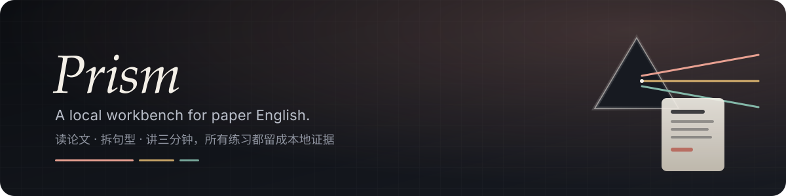
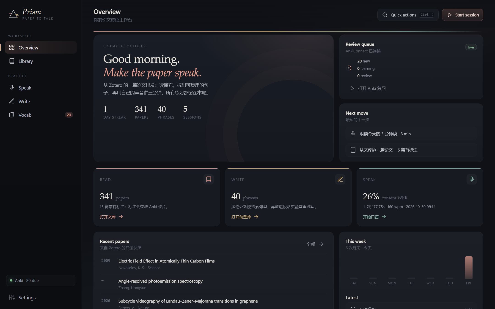
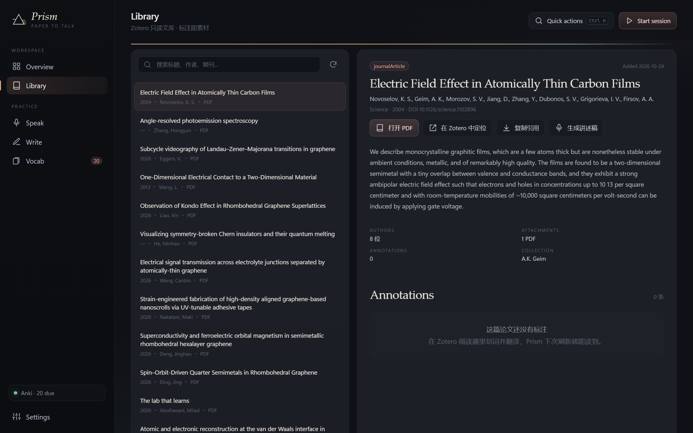
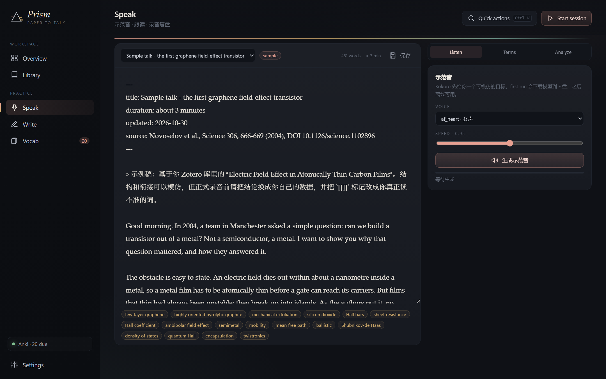
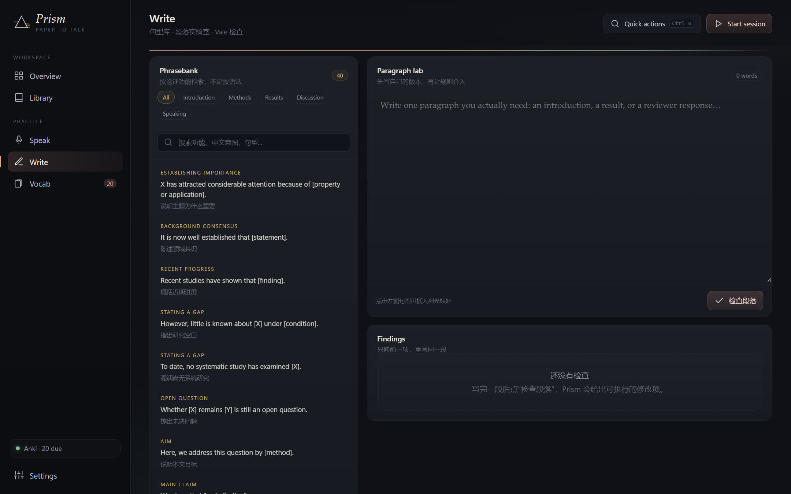
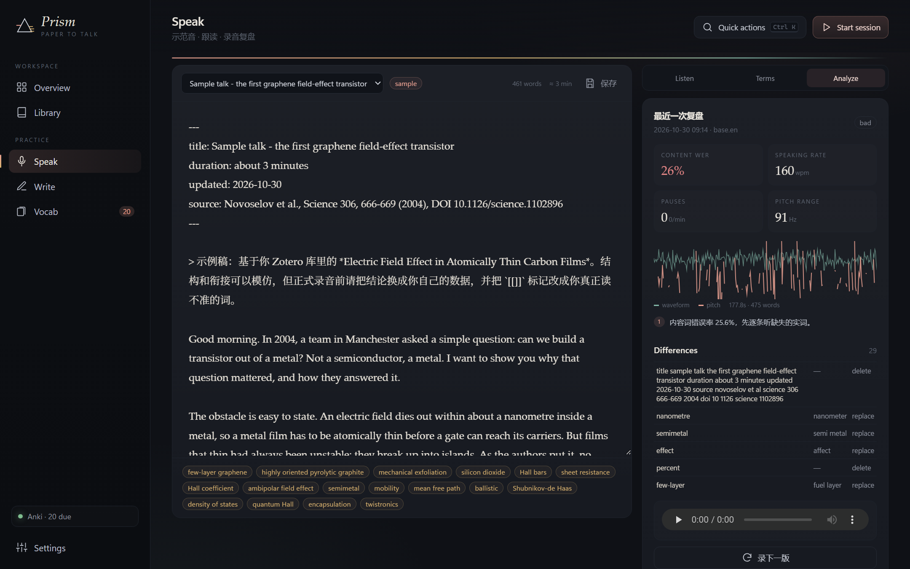

<p align="center">
  
</p>

<h1 align="center">Prism</h1>

<p align="center"><strong>把一篇论文拆成读、写、说三种练习，并留下可比较的证据。</strong></p>

<p align="center">
  <a href="https://github.com/Lumenhao/PaperToTalk"></a>
  
  
  
  <a href="LICENSE"></a>
  <a href="LICENSE-CONTENT.md"></a>
</p>

Prism 是一个**打开就能用**的本地工作台，不是文档合集。左边六栏对应你真正会做的六件事：看进度、翻 Zotero、练口语、改写作、复习词汇、检查工具链。所有数据留在本机；模型、缓存和工具链都收在 `E:\LumenSuite`。

> 名字沿自我上一件作品 **Lumen**（书房）。Lumen 收光，Prism 把一束光拆成光谱：同一篇论文，拆成 **Read · Write · Speak** 三条可练习的线。

---

## 打开它

```powershell
git clone https://github.com/Lumenhao/PaperToTalk.git
cd PaperToTalk
.\setup_env.ps1        # 首次：建 .venv、装 CPU 版 torch 与语音依赖
.\Prism.bat            # 之后每天：直接开工作台
```

`Prism.bat` 会启动本地服务并打开一个独立的 Edge 应用窗口；若 WebView2 可用，也会走 pywebview 原生窗口。浏览器访问 `http://127.0.0.1:7317` 同样可用。

首次合成语音与分析录音会下载模型（Kokoro ≈ 330 MB、Whisper base.en ≈ 150 MB），默认走 `hf-mirror.com`，全部落在 `E:\LumenSuite\models`。

```text
E:\LumenSuite
├─ Prism\     代码与 .venv（本仓库）
├─ tools\     Python 3.12、Anki、Vale、FFmpeg
├─ models\    Kokoro、Whisper、HuggingFace 缓存
├─ cache\     uv / pip 缓存
└─ data\      Edge 窗口配置
```

<table>
<tr>
<td></td>
<td></td>
</tr>
<tr>
<td></td>
<td></td>
</tr>
</table>

<p align="center"></p>

---

## 六个工作区

| 工作区 | 你在里面做什么 | 背后跑的 |
|---|---|---|
| **Overview** | 看本周练习、Zotero 规模、Anki 到期数、最近一次复盘；“Start session”直接进口语 | FastAPI `/api/overview` |
| **Library** | 搜索 341 篇 Zotero 文献；看摘要、作者、标签、标注；打开 PDF / 定位 Zotero；一键把论文生成 3 分钟讲述稿 | 只读 SQLite 快照 |
| **Speak** | 改稿 → Kokoro 示范音 → 17 个术语的 YouGlish 语境 → 上传录音 → Whisper 对齐 + Praat 指标 + 波形/音高图 | `speaking/speak.py` |
| **Write** | 按论证功能检索 40 条 Phrasebank；点一句插进段落实验室；Vale + 内置规则给出可执行修改 | `writing/` |
| **Vocab** | 读 Zotero 标注与翻译 → 预览 → 一键写入 Anki；看三个牌组的到期数；启动 Anki / 初始化牌组 | AnkiConnect 8765 |
| **Settings** | 改端口、Anki 路径、Zotero 库、Kokoro 音色、Whisper 模型；查看每个工具的真实路径与状态 | `config.json` + 工具探测 |

所有长任务（TTS、分析、Anki 导入）都在后台线程跑，界面显示进度，不会卡住窗口。

## 一条完整路径（用 2004 年那篇石墨烯论文）

1. **Library** 打开 *Electric Field Effect in Atomically Thin Carbon Films*（Novoselov et al., *Science* 306, 666–669, 2004）。
2. 点 **生成讲述稿**：Prism 用标题、作者、摘要和标注拼出一份约 450 词、3 分钟的稿子，术语用 `[[...]]` 标出。
3. **Speak** 里点 **生成示范音**：Kokoro 按术语读法表替换 HOPG / FLG / Shubnikov–de Haas，生成 `tts-*.wav`。
4. 跟读后录一版，**Analyze**：Whisper 转写 → 与稿子做 difflib 对齐 → Praat 测音高、强度、停顿 → 给出 3 条最值得改的动作。
5. **Vocab** 里把 Zotero 里带翻译的标注导出为 `PaperToTalk::Vocab` 卡片；**Write** 里用同一篇论文的论证动作写自己的段落。

## 架构

```text
Edge app window / browser
        │  fetch JSON
        ▼
FastAPI (127.0.0.1:7317) ── app/server.py
        │
        ├── services/library.py   Zotero SQLite 只读快照（原子复制，不碰原库）
        ├── services/speech.py    Kokoro · faster-whisper · parselmouth · difflib
        ├── services/writing.py   40 条 Phrasebank · Vale CLI / 内置规则
        ├── services/anki.py      AnkiConnect · 牌组/笔记类型 · 种子卡
        ├── services/tools.py     工具路径探测 · 打开文件夹/URL
        └── services/dashboard.py 练习记录 · 连续天数 · 周视图
        │
        ▼
E:\LumenSuite
├── Prism\       代码、data（音频/报告/快照）、.venv
├── tools\       anki · ffmpeg · praat · vale · ankiconnect
├── models\      hf（Kokoro、Whisper）· torch
└── cache\       下载缓存与截图
```

## 命令行仍然可用

工作台没有删掉原来的管线；它只是把它们包了一层。

```powershell
# 口语
.\.venv\Scripts\python speaking\speak.py tts speaking\samples\sample_talk.md --out speaking\samples\sample_talk.wav
.\.venv\Scripts\python speaking\speak.py links speaking\samples\sample_talk.md --out speaking\samples\youglish.md
.\.venv\Scripts\python speaking\speak.py check speaking\samples\take1.wav --script speaking\samples\sample_talk.md

# 词汇
.\.venv\Scripts\python vocab\zotero_to_anki.py --dry-run
.\.venv\Scripts\python vocab\anki_setup.py --check

# 写作
E:\LumenSuite\tools\vale\vale.exe --config=writing\.vale.ini path\to\draft.md

# 自检
python scripts\validate.py
python -m unittest discover -s tests
```

## 名字系列

| 名字 | 收什么 | 状态 |
|---|---|---|
| **Lumen** | 个人图书馆 / 阅读空间 | 已发布：[Lumenhao/Lumen](https://github.com/Lumenhao/Lumen) |
| **Prism** | 把一篇论文拆成读、写、说 | 本仓库 |
| *Aperture / Beacon / Vega* | 待定：镜头、灯塔、织女星 | 候选 |

同一个词根逻辑：光学与观测。Lumen 是光源，Prism 是分光，下一个应当是“成像”或“指向”。

## 当前状态

本机（Windows 11 · Python 3.12 · CPU）已实际跑通：

- **341 篇** Zotero 文献的只读索引；目标论文排第一；中文文件名可打开；
- **40 条** Phrasebank 种子卡写入 `PaperToTalk::Phrases`，AnkiConnect 已连接；
- Kokoro `af_heart` 合成 447 词 / **177.75 s** 示范音；
- Whisper `base.en` + Praat 分析真实录音：WER **16.2%**、内容词 WER **25.6%**、波形 320 点、音高 260 点、停顿检测；
- YouGlish 17 条术语链接；Vale 3.25.1 可执行；FFmpeg 7.1 就绪；
- 38 个单元测试与 `scripts/validate.py` 通过。

尚未完成：mpvacious / Buzz 的 GUI 流程仍按 `speaking/mpvacious.md`、`speaking/buzz-and-praat.md` 手工操作；macOS / Linux 启动脚本未验证。

## 隐私与许可

- Zotero 只读；Anki 通过本机 AnkiConnect 写入；不上传文章、录音或笔记。
- 代码 MIT；文档与训练材料 CC BY-NC 4.0；第三方归属见 [NOTICE.md](NOTICE.md)。
- 示例稿是 2004 年论文的口语改写，不含原文段落或图片。
- `data/`、模型与录音已在 `.gitignore` 中排除。

## 致谢

方法论与训练结构来自 [byoungd/up](https://github.com/byoungd/up) 的英语学习部分；界面气质参考 [odysseus](https://github.com/odysseus-dev/odysseus) 的深色工作台；语音、对齐与排版分别站在 Kokoro、faster-whisper、Praat、Vale、AnkiConnect 之上。
